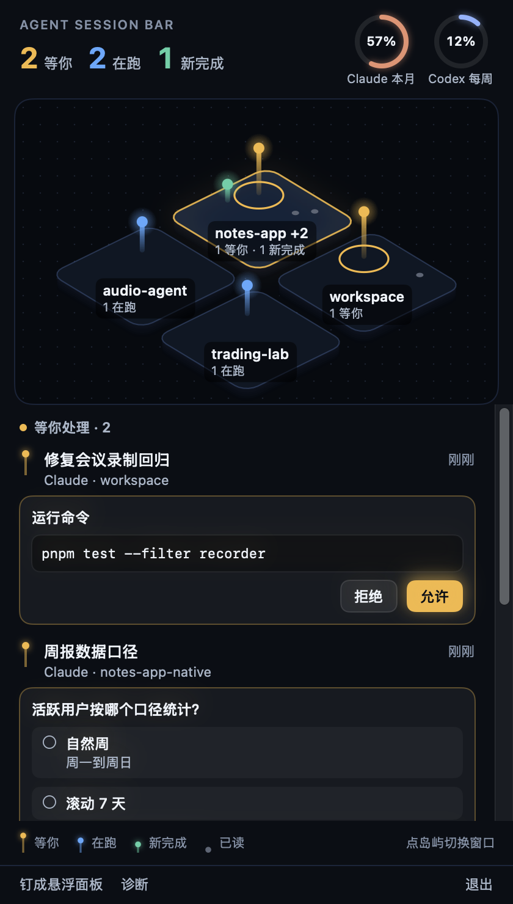
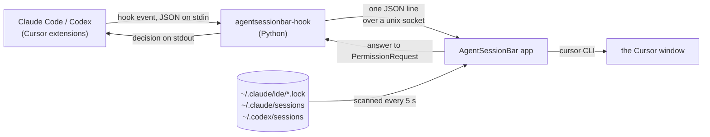

# AgentSessionBar

[English](#english) · [中文](#中文)

<p align="center"></p>

<p align="center"><sub>Formerly agent-deck.</sub></p>

---

## English

**Every Claude Code and Codex session in Cursor, in your macOS menu bar.** See which session is waiting on you, approve a command or answer a multiple-choice question without leaving the window you are in, and bring the right Cursor window to the front when you do need to go there. The conversation itself stays in the Cursor extension.

- **For you if** you run Claude Code (Codex optional) in the Cursor extension panel on macOS 14 or later, usually across several windows.
- **Not built for** agents running in a terminal. Tools built around terminals, such as [MioIsland](https://github.com/MioMioOS/MioIsland), or a terminal session manager fit that better. Claude Code's own `claude agents` view covers background sessions, not extension panels.
- The UI text is in Chinese for now.

### Install

```sh
brew install --cask mrright36988/tap/agentsessionbar
```

Or download `AgentSessionBar-<version>.zip` from [Releases](https://github.com/Mrright36988/AgentSessionBar/releases) and move `AgentSessionBar.app` to Applications. It is a universal binary, tested on Apple silicon. The hooks run with `/usr/bin/python3`, which comes with the Xcode Command Line Tools (`xcode-select --install`).

1. **Open it.** The app is not notarized, so macOS blocks the first launch: open System Settings → Privacy & Security and click **Open Anyway**. Then allow notifications (System Settings → Notifications → AgentSessionBar, if no prompt appears).
2. **Add the hooks.** Your settings files are backed up first:
   ```sh
   /usr/bin/python3 /Applications/AgentSessionBar.app/Contents/Resources/scripts/install.py install
   ```
   Claude Code picks them up immediately. Codex runs only trusted hooks: in Cursor, open Codex settings → Hooks and trust each `agentsessionbar-hook` entry.
3. **Start at login** (optional): System Settings → General → Login Items → add AgentSessionBar.

The same `install.py` also takes `status` and `doctor` (what is installed, which Codex hooks still need trust, whether the app is reachable) and `uninstall` (removes the hooks; if nothing else changed since install, your settings files are restored byte for byte). Run `uninstall` before you delete the app, and `uninstall` then `install` after an update so the hooks match the new version.

### Why

If you run many agent sessions across several Cursor windows, finding out who needs you means visiting every window and every tab, and an approval prompt can sit unnoticed in a window you are not looking at. AgentSessionBar puts all of them in one place.

### What it does

- **A map of your Cursor windows.** Each open window is an island; its sessions stand on it as beacons: amber and tallest with a spreading ring = waiting on you, blue and bobbing = running, green = just finished, grey dot = read. The six busiest windows get islands; the rest are listed under the map. Click an island to see its sessions.
- **Answer in place.** Claude Code permission prompts show the full command or diff with Allow / Deny; `AskUserQuestion` choices can be picked (or a custom answer typed). Whatever is waiting on you stays pinned at the top, whichever island is selected. Cursor keeps showing its own prompt, and whoever answers first wins.
- **Reply to Codex.** When a Codex session finishes, you can send it the next message from the menu bar (`codex queue`).
- **Jump to the window.** "跳到这个窗口" or a click on a session raises the Cursor window it runs in, including multi-root workspaces (saved `.code-workspace` or untitled).
- **Usage at a glance.** Rings for your Claude and Codex limits; click them for reset times and a forecast of when you will run out.
- **Notifications** when a session needs you or finishes, and a **floating panel** that stays on top across Spaces.
- Follows the system's **Reduce Motion** setting.

### How it works



- **Hooks.** `install.py` registers `agentsessionbar-hook` for `SessionStart`, `UserPromptSubmit`, `PermissionRequest`, `PostToolUse` and `Stop` in Claude Code and Codex, plus `StopFailure` in Claude Code and `SessionEnd` in Codex. Each event goes to the app over `~/Library/Application Support/AgentSessionBar/hook.sock` as one line: `{"v":1,"tool":"claude","event":"PermissionRequest","wait":true,"payload":{…}}`. Only `PermissionRequest` waits for a reply (`{"output": …}`), which the hook prints as its decision. If the app is not running, the hook exits within about 0.1 s and the session carries on as if nothing were installed.
- **Cursor's own agent.** Cursor also runs the hooks in `~/.claude/settings.json` for its built-in agent (Settings → Third-Party Imports). `agentsessionbar-hook` ignores those calls. Claude Code gets no `SessionEnd` hook because Cursor makes a closing window wait for it; the app notices an ended Claude session on its next scan instead.
- **Discovery.** Open Cursor windows come from the Claude Code extension's lock files (`~/.claude/ide/*.lock`), live Claude sessions from `~/.claude/sessions`, Codex threads from `~/.codex/sessions`. Headless runs (`claude -p`, `codex exec`) are ignored, including a `claude -p` that a session starts from its own scripts.
- **Jumping.** The window is raised with the `cursor` command, pointed at the folder, the saved `.code-workspace`, or for an untitled multi-root workspace the `workspace.json` Cursor keeps for it.
- **Usage.** Claude: the Claude Code binary that ships inside the Cursor extension answers a `get_usage` control request (the same data as the extension's usage panel). Codex: `rate_limits` from local rollout files. AgentSessionBar itself makes no network requests.

### Safety

- Answers go through the official hook decision channel only. AgentSessionBar never types into a session or fakes user input.
- The `agentsessionbar://diag/…` URLs used for development can raise windows and render images, but can never answer a prompt.
- Everything stays on your Mac.

### Limitations

- Jumping reaches the window, not the tab: pick the tab named in the app yourself.
- Claude Code has no official channel for sending free text into an extension session, so typed replies to Claude still go through the extension's input box.
- Codex approvals are listed but answered in Cursor.
- Built and tested with Cursor on macOS only.

### Build from source

Needs the Xcode Command Line Tools (Swift 6; Xcode itself is not needed) and `/usr/bin/python3`.

```sh
git clone https://github.com/Mrright36988/AgentSessionBar.git
cd AgentSessionBar
./scripts/build_app.sh                         # builds build/AgentSessionBar.app with SwiftPM
open build/AgentSessionBar.app                 # menu bar icon; allow notifications when asked
/usr/bin/python3 scripts/install.py install    # adds the hooks; backs up your settings first
```

- Optional: `scripts/make_signing_identity.sh` creates a local code-signing identity so macOS permissions survive rebuilds (you trust its certificate once); without it the app is signed ad hoc.
- Start at login: `scripts/autostart.sh on` installs a per-user LaunchAgent that starts the app at login and restarts it if it crashes (quitting from the menu stays quit). `autostart.sh off` removes it; it is also listed under System Settings → General → Login Items.
- Coming from agent-deck: `install.py uninstall` also removes the old agent-deck hooks, and `autostart.sh on` (or `off`) removes the old login agent and quits the old app. Then run `install.py install`.

### Development

```
Sources/DeckCore/          pure logic, no AppKit: hook protocol and socket server, inbox state machine,
                           on-disk session formats, window/workspace resolution, isometric map layout, usage parsing
Sources/AgentSessionBar/   the menu bar app: DeckStore (state and actions), UI/, Window/ (jumping),
                           Discovery/, Notify/, Codex/, Usage/, Diagnostics/
Tests/DeckCoreTests/       Swift tests for DeckCore
hook/                      agentsessionbar_hook.py, the command Claude Code and Codex run, with its tests
scripts/                   install.py (hooks), build_app.sh, release.sh, autostart.sh, make_signing_identity.sh
docs/                      requirements and research notes (in Chinese, written before the rename), spike probes, images
```

```sh
swift test                                                    # DeckCore
/usr/bin/python3 -m unittest discover -s hook -p 'test_*.py'
/usr/bin/python3 -m unittest discover -s scripts -p 'test_*.py'
open -g "agentsessionbar://diag/demo?windows=8"   # renders made-up sessions to ~/Library/Application Support/AgentSessionBar/demo-8.png
scripts/release.sh 0.1.0                          # universal zip in dist/, signed ad hoc, and its sha256
```

Other diagnostics: `diag/status`, `diag/dump` (inbox to the log), `diag/snapshot` (the live UI to a PNG), `diag/panel`, `diag/notify`.

### License

[MIT](LICENSE)

---

## 中文

**把 Cursor 里所有 Claude Code 和 Codex 会话放进 macOS 菜单栏。** 哪个会话在等你一眼就能看到；审批命令、回答选择题都不用离开当前窗口；真需要过去时，一键把对应的 Cursor 窗口切到前台。对话本身仍然留在 Cursor 插件里。

- **适合**：在 Cursor 的插件面板里用 Claude Code（Codex 可选），macOS 14 及以上，常常同时开好几个窗口。
- **不是为终端做的**：agent 跑在终端里的话，围绕终端做的工具（比如 [MioIsland](https://github.com/MioMioOS/MioIsland)）或终端会话管理器更合适。Claude Code 自带的 `claude agents` 视图管的是后台会话，不含插件面板里的会话。
- 界面文字目前是中文。

### 安装

```sh
brew install --cask mrright36988/tap/agentsessionbar
```

或者从 [Releases](https://github.com/Mrright36988/AgentSessionBar/releases) 下载 `AgentSessionBar-<版本>.zip`，把 `AgentSessionBar.app` 拖进“应用程序”。安装包是通用二进制，在 Apple 芯片上测试过。hook 用 `/usr/bin/python3` 运行，它随 Xcode Command Line Tools 一起安装（`xcode-select --install`）。

1. **打开**：app 没有经过苹果公证，第一次打开会被系统拦下。到“系统设置 → 隐私与安全性”点**仍要打开**。然后允许通知（没弹窗的话，去“系统设置 → 通知 → AgentSessionBar”打开）。
2. **安装 hook**（会先备份原有配置）：
   ```sh
   /usr/bin/python3 /Applications/AgentSessionBar.app/Contents/Resources/scripts/install.py install
   ```
   Claude Code 装完立即生效。Codex 只执行受信任的 hook：在 Cursor 里打开 Codex 设置 → Hooks，逐条信任 `agentsessionbar-hook` 的条目。
3. **开机启动**（可选）：在“系统设置 → 通用 → 登录项”里添加 AgentSessionBar。

同一个 `install.py` 还支持 `status` / `doctor`（装了什么、哪些 Codex hook 还没信任、app 能否连通）和 `uninstall`（移除 hook；如果安装后配置没有别的改动，会逐字节还原原文件）。删除 app 之前先跑 `uninstall`；更新后先 `uninstall` 再 `install`，让 hook 和新版本一致。

### 为什么做

同时在好几个 Cursor 窗口里跑很多个 agent 会话时，想知道谁在等你，只能挨个窗口、挨个 tab 去看；一个审批请求可能就停在你没在看的窗口里，迟迟没人处理。AgentSessionBar 把它们集中到一处。

### 能做什么

- **Cursor 窗口地图**：每个打开的窗口是一座岛，会话是岛上的光柱。琥珀色、最高、带扩散光圈的是在等你；蓝色、上下浮动的是在跑；绿色是刚完成；灰点是已读。最忙的 6 个窗口画成岛，其余列在地图下方。点岛屿查看它的会话。
- **就地作答**：Claude Code 的权限请求会显示完整命令或 diff，可以直接允许或拒绝；`AskUserQuestion` 选择题可以直接选，也可以自己写答案。等你处理的卡片固定在最上面，和选中哪座岛无关。Cursor 里的提示照常显示，哪边先答算哪边的。
- **回复 Codex**：Codex 会话结束后，可以在菜单栏里直接发下一条消息（`codex queue`）。
- **跳到窗口**：点“跳到这个窗口”或点会话，把它所在的 Cursor 窗口切到前台，支持多根 workspace（已保存的 `.code-workspace` 和未保存的都行）。
- **用量一眼可见**：Claude 和 Codex 的额度用圆环显示；点开能看重置时间，以及按当前速度预计何时用完。
- 会话等你或完成时发**系统通知**；可以**钉成悬浮面板**，在所有桌面空间置顶显示。
- 跟随系统的**减弱动态效果**设置。

### 工作原理

（流程图见上方英文部分）

- **Hook**：`install.py` 在 Claude Code 和 Codex 里为 `SessionStart`、`UserPromptSubmit`、`PermissionRequest`、`PostToolUse`、`Stop` 注册 `agentsessionbar-hook`，Claude Code 另加 `StopFailure`，Codex 另加 `SessionEnd`。每个事件通过 `~/Library/Application Support/AgentSessionBar/hook.sock` 以一行 JSON 发给 app：`{"v":1,"tool":"claude","event":"PermissionRequest","wait":true,"payload":{…}}`。只有 `PermissionRequest` 会等待回复（`{"output": …}`），hook 把它作为决定输出。app 没在运行时，hook 约 0.1 秒内退出，会话照常进行，就像没装过一样。
- **Cursor 自带的 Agent**：Cursor 也会拿 `~/.claude/settings.json` 里的 hook 去跑它自带的 Agent（设置 → Third-Party Imports），`agentsessionbar-hook` 会忽略这些调用。Claude Code 不注册 `SessionEnd`，因为 Cursor 关窗时要等它跑完；Claude 会话结束改由 app 下一次扫描发现。
- **发现会话**：打开的 Cursor 窗口来自 Claude Code 插件的锁文件（`~/.claude/ide/*.lock`），存活的 Claude 会话来自 `~/.claude/sessions`，Codex 会话来自 `~/.codex/sessions`。无头运行（`claude -p`、`codex exec`）会被忽略，会话自己在脚本里起的 `claude -p` 也一样。
- **跳转**：用 `cursor` 命令拉起窗口，参数是目录、已保存的 `.code-workspace`，或者未保存的多根 workspace 在 Cursor 里对应的 `workspace.json`。
- **用量**：Claude 部分由 Cursor 插件自带的 Claude Code 程序响应 `get_usage` 控制请求，数据和插件的用量面板同源；Codex 部分读本地 rollout 文件里的 `rate_limits`。AgentSessionBar 本身不发任何网络请求。

### 安全

- 只通过官方的 hook 决定通道作答，从不往会话里打字，也不伪造用户输入。
- 开发用的 `agentsessionbar://diag/…` 链接能拉起窗口、渲染图片，但不能回答任何请求。
- 所有数据都留在本机。

### 已知限制

- 跳转只能到窗口，不能自动切到 tab：按 app 上写的会话名自己点一下。
- Claude Code 没有向插件会话发送文字的官方通道，给 Claude 打字回复仍要在插件输入框里完成。
- Codex 的审批会列出来，但要在 Cursor 里处理。
- 只在 macOS 上的 Cursor 中构建和测试过。

### 从源码构建

需要 Xcode Command Line Tools（Swift 6，不需要装 Xcode）和 `/usr/bin/python3`。

```sh
git clone https://github.com/Mrright36988/AgentSessionBar.git
cd AgentSessionBar
./scripts/build_app.sh                         # 用 SwiftPM 构建 build/AgentSessionBar.app
open build/AgentSessionBar.app                 # 出现菜单栏图标；系统询问时允许通知
/usr/bin/python3 scripts/install.py install    # 安装 hook，先备份原有配置
```

- 可选：`scripts/make_signing_identity.sh` 生成本地签名证书，重新构建后系统权限不会失效（需要你手动信任一次证书）；不生成的话用临时签名。
- 开机自启：`scripts/autostart.sh on` 会装一个用户级 LaunchAgent，登录时启动 app，崩溃了自动拉起；在菜单里点“退出”就是真的退出。`autostart.sh off` 可以关掉，在“系统设置 → 通用 → 登录项”里也能看到和关闭它。
- 从 agent-deck 升级：`install.py uninstall` 会一并移除旧的 agent-deck hook，`autostart.sh on`（或 `off`）会移除旧的登录项并退出旧 app。之后再跑 `install.py install`。

### 开发

目录结构、测试命令和诊断链接见上方英文部分。`docs/` 里是需求文档和验证记录（中文，写于改名之前）。

### 许可证

[MIT](LICENSE)
